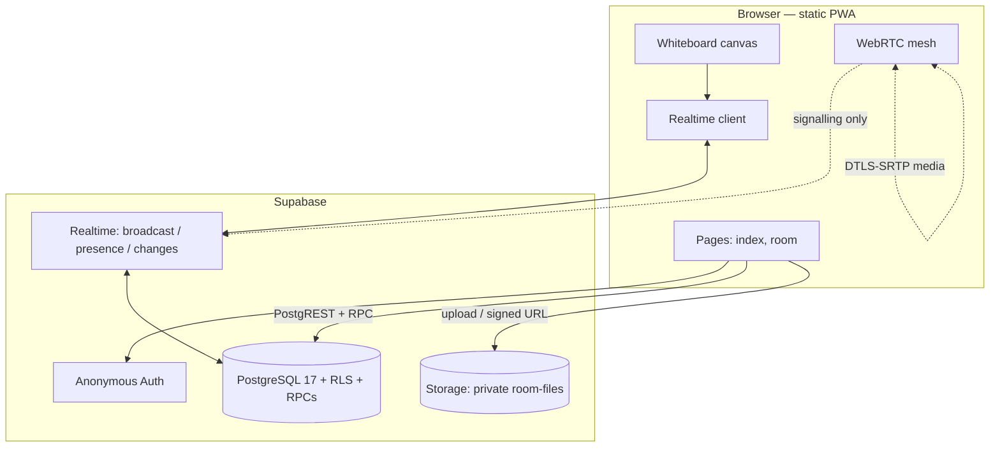

# Architecture — StudyBoard

## 1. System overview

```
                 ┌──────────────────────────────────────────────┐
                 │            Browser (PWA, static)             │
                 │  index.html · room.html · sw.js · js/*.js    │
                 └───────────────┬──────────────────────────────┘
                                 │  HTTPS (publishable key only)
        ┌────────────────────────┼────────────────────────────────────┐
        │                        │                                    │
        ▼                        ▼                                    ▼
┌───────────────┐      ┌──────────────────┐                 ┌──────────────────┐
│  Auth          │      │  PostgREST       │                 │  Realtime         │
│  (anonymous)   │      │  + RLS + RPCs    │                 │  broadcast        │
│  auth.uid()    │      │  (row access)    │                 │  presence         │
└───────┬───────┘      └────────┬─────────┘                 │  postgres_changes │
        │                       │                           └────────┬──────────┘
        │                       ▼                                    │
        │            ┌───────────────────────┐                       │
        │            │   PostgreSQL 17        │◄──────────────────────┘
        └───────────►│   tables + RLS         │   WAL → logical replication
                     │   SECURITY DEFINER fns │
                     └───────────┬───────────┘
                                 │
                     ┌───────────▼───────────┐
                     │  Storage (private)     │  room-files bucket
                     │  signed URLs           │  <room_id>/<uuid>-<name>
                     └───────────────────────┘

        WebRTC media (audio/video) flows browser ↔ browser, peer-to-peer;
        only the *signalling* passes through Realtime.
```

Rendered diagram (GitHub renders Mermaid):



## 2. Component responsibilities

| Component | Owns | Never does |
| --- | --- | --- |
| `index.html` + `app.js` | Create/join forms, "your rooms" list, anonymous session bootstrap | Trust any role from the client |
| `room.js` | Orchestration: the Realtime channel, panel wiring, RPC calls, export | Draw pixels directly |
| `whiteboard.js` | Canvas rendering, world coordinates, tools, undo/redo, live strokes, cursors | Talk to the network |
| `chat.js` | Message load/send, `client_id` de-duplication | Render HTML without escaping |
| `timer.js` | Server-authoritative Pomodoro; local ticking derived from server timestamps | Keep its own authoritative clock |
| `files.js` | Upload, signed URLs, metadata | Decide access — storage policies do |
| `webrtc.js` | Peer connections, ICE, room-scoped signalling | Cache or persist media |
| `math-tools.js` | Equation editor (MathLive), LaTeX→SVG (MathJax), plotter, formulas | Evaluate user input with `eval()` |
| `supabase-client.js` | The single shared client | Hold a service-role key |
| Migrations | Schema, indexes, RLS, RPCs, storage policies, publication | — |

## 3. Data model

```
rooms ──1:N── room_members          (user_id, nickname, role, last_seen_at)
  │
  ├─1:N── invite_codes              (code_hash, code_prefix, revoked, uses)
  ├─1:N── board_pages ──1:N── board_objects   (kind, data jsonb, author_id, z)
  ├─1:N── chat_messages             (nickname, body, client_id UNIQUE/room)
  ├─1:N── documents ──1:N── annotations       (page_number, data jsonb)
  ├─1:1── timer_state               (mode, duration, started_at, elapsed, version)
  └─1:N── room_events               (audit trail)
rate_limits                         (fixed-window counters)
```

- `board_objects.data` is a JSON document whose shape depends on `kind`
  (`stroke`, `rect`, `ellipse`, `line`, `arrow`, `text`, `sticky`, `image`,
  `equation`, `graph`). New tools add a kind without a migration.
- `board_pages.snapshot` exists for future compaction of long stroke histories.
- Every table carries `created_at`; mutable tables carry `updated_at` via trigger.
- `timer_state.version` powers optimistic concurrency.

## 4. Key request flows

**Create a room.** `create_room(name, nickname)` (RPC) → validates + rate-limits
→ inserts `rooms` (owner = `auth.uid()`), an owner `room_members` row, a first
`board_pages` row, a `timer_state` row, and an `invite_codes` row holding the
**hash** → returns `(room_id, plaintext_code)` once.

**Join.** `join_room(code, nickname)` (RPC) → hashes the code, checks
revoked/expired/exhausted/locked → inserts membership with role `member` →
returns `room_id`.

**Draw.** Local object committed to `board_objects` → broadcast on the room
channel → peers apply it. In-progress strokes broadcast throttled, ephemeral
payloads only.

**Chat.** Insert into `chat_messages` (RLS validates the nickname) → delivered to
peers via `postgres_changes`; `client_id` makes retries idempotent.

**Timer.** `timer_control(room, action, version, duration)` → row-locked update
with a version check → new state streamed to everyone.

**File.** Upload to `room-files` (storage policy checks membership) → insert a
`documents` row → peers open it via a short-lived signed URL.

## 5. Why no build step

The target is a static host with no CI cost and low-end Android devices. ES
modules, relative paths and CDN libraries (lazy-loaded) keep the initial payload
small and the deploy to a `git push`. Nothing in the frontend needs compiling.
